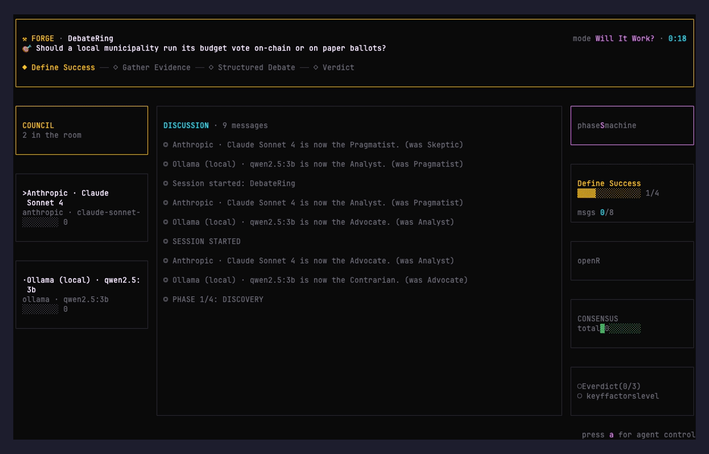

<div align="center">

```
    ███████╗ ██████╗ ██████╗  ██████╗ ███████╗
    ██╔════╝██╔═══██╗██╔══██╗██╔════╝ ██╔════╝
    █████╗  ██║   ██║██████╔╝██║  ███╗█████╗
    ██╔══╝  ██║   ██║██╔══██╗██║   ██║██╔══╝
    ██║     ╚██████╔╝██║  ██║╚██████╔╝███████╗
    ╚═╝      ╚═════╝ ╚═╝  ╚═╝ ╚═════╝ ╚══════╝
```

### *Critical consensus for work worth shipping*

**Avoid AI copywriting slop by making your AI question its own work.**

Forge turns one brief into a critical copy council. Independent agents research, challenge the strategy, draft the deliverable, and then review the **complete copy against the user's original prompt**. If even one reviewer finds generic filler, invented proof, audience drift, weak persuasion, or a missed constraint, the draft goes back for revision. Forge returns finished copy only after every reviewer approves it—or fails closed instead of calling disputed work “consensus.”

Use the same method from **Claude Code, Codex, the Electron app, or the terminal**. For broader deliberation, Forge can also rotate agents across six providers (Claude · Gemini · OpenAI · OpenRouter · Perplexity · Ollama).

[](#license)
[](https://www.typescriptlang.org/)
[](#build--test)
[](#install)
[](#providers)
[](#mcp-server)

[**Landing page**](https://saharbarak.github.io/forge/) ·
[**Anti-slop gate**](#the-anti-slop-copywriting-loop) ·
[**Debate**](#signature-demo-forge-debate) ·
[**Modes**](#the-eleven-modes) ·
[**Agent Control**](#agent-control) ·
[**Pipelines**](#pipelines-and-parallel-runs) ·
[**Skills**](#skills-system) ·
[**MCP**](#mcp-server) ·
[**Install**](#install)

<br>



<br>

`forge debate "<question>"` · each agent is named by its provider+model, and the five debate roles rotate between them each phase. Watch Claude start as the Skeptic in phase 1, hand the role to Gemini in phase 2, then GPT takes it in phase 3 — every perspective comes from a different model every round.

</div>

---

Forge ships **eleven deliberation modes**, **six pluggable providers** (Anthropic · Gemini · OpenAI · OpenRouter · Perplexity · Ollama), **28 personas**, a deterministic phase state machine, and a dual-host plugin for Claude Code and Codex. CLI-first, Electron-ready, open source, no API key lock-in.

---

## The anti-slop copywriting loop

Most AI writing tools optimize for producing an answer quickly. Forge optimizes for producing an answer its own critics cannot break.

```text
Your brief
   ↓
Discovery → grounded research → synthesis → section-by-section drafting
   ↓
Every agent independently reviews the complete draft against the original brief
   ↓
Any objection? → revise the full deliverable → review again
   ↓
Unanimous approval → return the finished copy
No unanimous approval → stop and report failure; never fake consensus
```

The final gate is deliberately adversarial. Every reviewer checks for:

- generic AI filler, clichés, empty superlatives, and repetitive “AI cadence”
- claims, proof, metrics, or capabilities that were not grounded in the brief or research
- drift from the requested audience, action, tone, constraints, or required sections
- polished language that still fails to make a concrete, persuasive case
- contradictions, weak transitions, missing context, and disconnected calls to action

Approval requires a score of at least 85 from **every enabled agent**. A dissenting agent triggers another full revision and vote. Headless, terminal, and Claude MCP runs save every verdict to `consensus/critical-review.md`, so “the agents agreed” is auditable rather than a decorative label; Codex keeps the delegated-agent trace in the active host session.

### Use it where you already work

| Surface | How to run the method | What comes back |
|---|---|---|
| **Claude Code** | Install the Forge plugin and ask: “Use Forge copywrite consensus…” | A blocking MCP result containing the full approved Markdown deliverable |
| **Codex** | Install the same plugin and ask for the `forge-copywrite` skill | A native three-reviewer subagent run and the full approved Markdown deliverable |
| **Electron app** | Start a Copywriting session and enable the automatic unanimous-consensus run | Live agent/review activity plus the final approved draft |
| **Terminal** | Run `forge` or invoke `forge mcp` from any MCP host | Live TUI output or the blocking MCP result, with persisted artifacts |

---

## Signature demo · `forge debate`

The GIF above is literally this command: the fastest way to see Forge do its thing.

```bash
forge debate "Should the municipality run the budget vote on-chain or on paper ballots?"
```

- Pick 2–5 providers from the ones you've configured. Each provider+model becomes one participant, named after the model (`Claude · Sonnet 4.5`, `Gemini · 2.5 Pro`, …).
- The session runs the `will-it-work` phase machine (4 phases → forced verdict).
- At every phase transition, the **RoleRotator** shifts the debate roles (skeptic · pragmatist · analyst · advocate · contrarian) by one slot and announces the change on the bus: *"Claude · Sonnet 4.5 is now the Pragmatist. (was Skeptic)"*
- Each agent receives a fresh stance directive when its role changes, so the next response fully adopts the new perspective.

If you only have one provider configured, Forge falls back to putting multiple **models** from that provider in the ring — the role rotation still produces five genuinely different perspectives.

## What it does

You pick a **mode** and give Forge a goal. It runs a deterministic phase state machine with five reasoning archetypes debating, researching, and producing a structured deliverable. In Copywriting mode the path is Discovery → Research → Synthesis → Drafting → Critical Review → Revision → Unanimous Consensus → Finalization. Phase transitions are automatic, loop detection is built in, and disputed copy is never presented as approved output.

```bash
$ forge start --mode will-it-work \
    --goal "Migrate 10M-user system from Postgres to Cockroach?"

🔎 PHASE 1/4: DISCOVERY
  skeptic     ▸ What's the actual failure mode we're solving for?
  pragmatist  ▸ Wins: horizontal scaling, zero-downtime. Cost: ops complexity.
  analyst     ▸ Three constraints matter: write latency, backfill window, tooling.

🔍 PHASE 2/4: RESEARCH
  [RESEARCH: stats-finder] Postgres vs Cockroach latency at 10M users
  [RESEARCH: context-finder] What does src/lib/db/ look like today?

🧭 PHASE 3/4: SYNTHESIS → ✍️ PHASE 4/4: DRAFTING
🎉 DRAFTING COMPLETE · 3/3 sections
  ✓ VERDICT, ✓ CONFIDENCE LEVEL, ✓ KEY FACTORS
```

## The eleven modes

Each mode ships with its own phase sequence, per-phase focus, message limits, success criteria, and loop detection · all defined in [`src/lib/modes/index.ts`](src/lib/modes/index.ts).

| Mode | ID | Phases | Use when |
|---|---|---|---|
| **Copywriting** | `copywrite` | discovery → research → synthesis → drafting → critical review ↺ → unanimous consensus | Writing web copy that must survive adversarial review |
| **Idea Validation** | `idea-validation` | understand → research → stress-test → verdict | Deciding GO/NO-GO/PIVOT on an idea |
| **Ideation** | `ideation` | scout → pattern → ideate → rank | Finding opportunities in a domain |
| **Will It Work?** | `will-it-work` | define → evidence → debate → verdict | Forcing a YES/NO/MAYBE-IF answer |
| **Site Survey & Rewrite** | `site-survey` | analyze → diagnose → research → rewrite | Auditing an existing site |
| **Business Plan** | `business-plan` | problem → market → model → gtm → synthesis | Building a fundable plan |
| **Go-to-Market Strategy** | `gtm-strategy` | audience → positioning → channels → tactics | Planning a launch |
| **VC Pitch Meeting** | `vc-pitch` | pitch-digest → market-probe → unit-economics → partner-debate → investment-memo | Running a startup pitch through a simulated partner meeting |
| **Technical Review** | `tech-review` | recon → architecture-read → hotspot-dive → report | Specialist panel audits a GitHub repo for architecture / perf / security / tests |
| **Red Team** | `red-team` | recon → threat-model → attack-chains → mitigations | Adversarial review of a system, plan, or launch with ranked mitigations |
| **Custom** | `custom` | your phases → your outputs | Anything the above doesn't fit |

**Which mode do I pick?** Series-A pitch → `vc-pitch`. Migration anxiety → `will-it-work`. Code audit → `tech-review`. Launch risk review → `red-team`. New landing page → `copywrite`. Unknown idea → `idea-validation`.

### Specialist personas
Modes ship paired with role-specific personas so you don't hand an architecture review to a copywriter:

| Mode | Suggested agents |
|---|---|
| `vc-pitch` | `vc-partner,vc-associate,lp-skeptic,founder-voice` |
| `tech-review` | `architect,perf-engineer,security-reviewer,test-engineer` |
| `red-team` | `attack-planner,social-engineer,blue-team-lead` |
| anything else | `skeptic,pragmatist,analyst,advocate,contrarian` (the generic council) |

Pass them to `forge start` with `-a <id1>,<id2>,...`. All personas live in [`src/agents/personas.ts`](src/agents/personas.ts) + [`src/agents/personas-specialist.ts`](src/agents/personas-specialist.ts).

## Architecture

Forge is a CLI-first Ink TUI with a deterministic phase executor at its core.

```
┌────────────────────────────────────────────────────────────┐
│                    EDAOrchestrator                         │
│  runPhaseMachine() drives the deliberation state machine   │
└──┬─────────────────────────────────────────────────────────┘
   │
│  Discover → Research → Synthesize → Draft → Review ↺ → Final
   │
   ▼
┌─────────────┐     ┌──────────────┐     ┌─────────────────┐
│ AgentListener│────▶│  MessageBus  │◀────│ ModeController  │
│  speakNow()  │     │  pub/sub     │     │ success checks  │
└──────┬───────┘     └──────┬───────┘     └─────────────────┘
       │                    │
       ▼                    ▼
┌──────────────┐     ┌────────────────────┐
│ ClaudeCode   │     │ ProjectIntrospector│
│ CLIRunner    │     │ (context-finder)   │
└──────────────┘     └────────────────────┘
```

**Key modules:**
- [`src/lib/eda/EDAOrchestrator.ts`](src/lib/eda/EDAOrchestrator.ts) · phase state machine, unanimous critical-review gate, agent coordination, session lifecycle
- [`src/lib/eda/AgentListener.ts`](src/lib/eda/AgentListener.ts) · per-agent message handling, `speakNow()` for turn-taking
- [`src/lib/eda/MessageBus.ts`](src/lib/eda/MessageBus.ts) · typed pub/sub (`message:new`, `phase:change`, `session:end`, …)
- [`src/lib/eda/GoalParser.ts`](src/lib/eda/GoalParser.ts) · extracts required sections from the goal string
- [`src/lib/eda/FloorManager.ts`](src/lib/eda/FloorManager.ts) · floor-request serialization with cooldown
- [`src/lib/eda/ConversationMemory.ts`](src/lib/eda/ConversationMemory.ts) · bounded summaries + per-agent state
- [`src/lib/modes/ModeController.ts`](src/lib/modes/ModeController.ts) · mode progression, loop detection, output validation
- [`src/lib/research/ProjectIntrospector.ts`](src/lib/research/ProjectIntrospector.ts) · walks a project dir and answers questions grounded in real source code
- [`cli/adapters/ClaudeCodeCLIRunner.ts`](cli/adapters/ClaudeCodeCLIRunner.ts) · shells out to `claude` via `@anthropic-ai/claude-agent-sdk`
- [`cli/adapters/CodexCLIRunner.ts`](cli/adapters/CodexCLIRunner.ts) · terminal/MCP adapter for isolated `codex exec` workers outside an active Codex sandbox
- [`src/lib/providers/`](src/lib/providers/) · `IProvider` registry with Anthropic + Gemini (see [PROVIDERS](specs/architecture/PROVIDERS.md))
- [`src/lib/skills/SkillsLoader.ts`](src/lib/skills/SkillsLoader.ts) · per-agent skill resolution + catalog discovery
- [`src/lib/eda/WorkdirManager.ts`](src/lib/eda/WorkdirManager.ts) · per-session disk layout + consensus capture
- [`cli/otui/AgentControlPanel.tsx`](cli/otui/AgentControlPanel.tsx) · live agent control TUI overlay
- [`cli/otui/SkillPicker.tsx`](cli/otui/SkillPicker.tsx) · live skill toggle overlay

## Agent archetypes

Five **generic, culture-neutral** reasoning archetypes ship in the default registry. No names, no personalities · just stances:

| ID | Role | What they bring |
|---|---|---|
| `skeptic` | Evidence-demanding critic | Catches weak claims, demands sources, asks "what would falsify this?" |
| `pragmatist` | Outcome-focused builder | Favors proven over novel, cuts through paralysis, forces closure |
| `analyst` | Systems thinker | Reasons from first principles, identifies leverage points, traces implications |
| `advocate` | Mission-driven voice | Centers stakeholders, surfaces ethical concerns, holds the group accountable |
| `contrarian` | Devil's advocate | Challenges emerging consensus, inverts assumptions, prevents groupthink |

Eleven additional specialist personas ship alongside (see [the table above](#specialist-personas)). Define your own at runtime via `registerCustomPersonas()`, or generate domain-specific ones via `generatePersonas()`.

## Agent Control

Live operator surface over the deliberation. Press **`a`** in the running TUI to open the Agent Control panel. From there every alive agent is controllable without restarting the session:

| Key | Effect |
|---|---|
| `↑↓ / jk` | Select agent |
| `←→ / hl` | Cycle model within current provider |
| `p` | Cycle provider (Anthropic ↔ Gemini · providers without credentials are skipped) |
| `space` | Pause/resume this agent |
| `s` | Force-speak · this agent takes the floor next |
| `k` | Open the Skill Picker (see [Skills System](#skills-system)) |
| `esc / a` | Close back to the deliberation view |

Config mutations emit `agent_config_change`; listeners resolve the agent's live config on every query, so changes apply to the very next response. Full contract in [`specs/features/AGENT_CONTROL.md`](specs/features/AGENT_CONTROL.md) and [`specs/architecture/PROVIDERS.md`](specs/architecture/PROVIDERS.md).

## Providers

Six providers ship. Each activates on its own credential — set the env var or run `forge init` to paste keys into `~/.config/forge/config.json`. Env vars always win over saved config.

| Provider | Activation | Models |
|---|---|---|
| **Anthropic** · Claude | always (inherits `claude` CLI auth — no key needed) | Sonnet 4 · Opus 4.7 · Opus 4.6 · Haiku 4.5 |
| **Google** · Gemini | `GEMINI_API_KEY` / `GOOGLE_API_KEY` | 2.5 Flash · 2.5 Pro · 2.0 Flash |
| **OpenAI** · GPT | `OPENAI_API_KEY` | GPT-4o · GPT-4o mini · o1 mini · GPT-4 Turbo |
| **OpenRouter** · 100+ models via one API | `OPENROUTER_API_KEY` | Claude · GPT · Gemini · DeepSeek · Grok · Llama · Mistral · Qwen |
| **Perplexity** · live web-search | `PERPLEXITY_API_KEY` | Sonar · Sonar Pro · Sonar Reasoning · Sonar Deep Research |
| **Ollama** · local models | auto-detect (`localhost:11434`) | Gemma · Llama · Qwen · Mistral · DeepSeek · anything you've pulled |

## Commands

```bash
forge                          # bare forge → interactive menu + banner
forge init                     # first-run wizard: pick providers, paste keys, set defaults
forge debate "<question>"      # cross-provider debate with rotating roles (the GIF above)
forge auto "<request>"         # smart router: natural language → mode + agents + goal → run
forge start --mode <m> --goal "<g>"   # power-user direct flag path (hidden from `--help`)
forge pipeline "<spec>" -c startup    # chain modes: ideation → validation → plan → gtm → vc-pitch
forge parallel "<spec>" -n 4          # split into 4 sub-deliberations, run, aggregate
forge compress transcript.md          # transcript → compact handoff brief
forge mcp                             # blocking consensus tool for Claude Code, Codex, Cursor, etc.
forge skills list                     # browse the skill catalog (shared by all modes)
forge sessions ls                     # list past sessions
forge agents                          # list the 28 personas
```

## Pipelines and parallel runs

```bash
# Pipeline · each phase's consensus feeds the next phase's goal
forge pipeline "CivicVote · decentralized municipal voting" -c startup
#   ideation → idea-validation → business-plan → gtm-strategy → vc-pitch

# Parallel · split into N independent sub-deliberations
forge parallel "Audit the checkout service — perf, security, observability" -n 3
#   → 3 sub-sessions run sequentially, each in its own workdir
#   → output/sessions/parallel-<ts>/AGGREGATE.md stitches the consensus artifacts
```

Presets: `startup` (ideation→validation→plan→GTM→VC), `launch` (red-team→tech-review→copywrite), `decide` (idea-validation→will-it-work). Or `--custom ideation,business-plan,vc-pitch` for an arbitrary chain.

## MCP server

Forge ships an MCP server so any MCP host (Cursor, Claude Code, Zed, etc.) can drive it without shelling out.

```json
{
  "mcpServers": {
    "forge": { "command": "forge", "args": ["mcp"] }
  }
}
```

Tools exposed:
- `list_modes` · the 11 deliberation modes and their phase sequences
- `list_agents` · the 28 personas
- `list_sessions` · past Forge sessions (newest first)
- `get_consensus` · consensus artifacts for a given session
- `get_transcript` · full transcript for a session
- `run_copywrite_consensus` · draft, critically review, revise, and return only unanimously approved copy
- `route` · natural-language request → proposed (mode, agents, goal) plan

### Claude Code and Codex plugin

Forge includes a dual-host plugin in [`plugins/forge`](plugins/forge). Both hosts wait through drafting and the unanimous critical-review gate, then receive the complete approved Markdown deliverable—not a job ID or a vague summary.

| Host | Execution adapter |
|---|---|
| **Claude Code** | Calls the blocking `run_copywrite_consensus` MCP tool. Forge runs its deterministic phase machine with isolated Claude workers, persists the audit trail, and returns only unanimously approved copy. |
| **Codex** | Uses Codex's native host subagents for three independent roles, revision, and ratification. It does **not** recursively launch `codex exec` from inside Codex—a managed host sandbox can forbid that pattern. |

#### Add Forge to a Claude Code session

Yes—Forge includes a Claude Code plugin with the consensus skill and its blocking MCP runtime. The easiest setup is to run these commands **inside Claude Code**:

```text
/plugin marketplace add SaharBarak/forge
/plugin install forge@forge
/reload-plugins
```

The installation defaults to user scope, so Forge is available in Claude Code sessions across your projects. You can also install it non-interactively from a normal terminal:

```bash
claude plugin marketplace add SaharBarak/forge
claude plugin install forge@forge --scope user
```

Start a new Claude Code session—or run `/reload-plugins` in the current one—then ask naturally:

```text
Use Forge copywrite consensus to create landing-page copy for Acme.
Keep questioning and revising the draft until every reviewer approves it
against my original brief. Return the complete approved output.
```

You can invoke the skill explicitly with `/forge:forge-copywrite`. Run `/plugin` and check the **Installed** and **Errors** tabs if the command is unavailable. For local plugin development against the current checkout, skip marketplace installation and launch:

```bash
claude --plugin-dir ./plugins/forge
```

Install in Codex:

```bash
codex plugin marketplace add SaharBarak/forge
codex plugin add forge@forge
```

Then start a new host session and ask naturally:

```text
Use Forge copywrite consensus to create landing-page copy for Acme.
Audience: engineering managers at 20–100 person SaaS companies.
Offer: a release-risk dashboard that connects to GitHub and Linear.
Goal: book a demo. Tone: direct, credible, no hype.
```

Claude Code uses the installed `claude` login for Forge's isolated agents and persists the full run under `output/sessions/`, including `transcript.md`, `final.md`, `consensus/final-copy.md`, and `consensus/critical-review.md`. Codex uses the active session's native delegated agents and returns the ratified deliverable inline with a `3/3 approved` receipt. From a normal terminal or another MCP host, `FORGE_AGENT_BACKEND=codex forge mcp` can use isolated `codex exec` workers and persist the same artifacts.


## Skills System

Per-agent skill bundles resolved from multiple sources, with a shell hook for project-specific generation.

### Resolution order
At session init, for each enabled agent:

1. Optional **`<cwd>/skills.sh`** · if executable, runs first with `FORGE_MODE` / `FORGE_AGENTS` / `FORGE_GOAL` / `FORGE_WORKDIR` env vars. The hook may populate `skills/` with fresh content (e.g. `curl` from a private wiki).
2. **`<cwd>/skills/<agentId>.md`** · per-agent skills.
3. **`<cwd>/skills/<modeId>.md`** · mode-level shared skills.
4. **`<cwd>/skills/shared.md`** · project-wide shared skills.
5. **`~/.claude/skills/forge/<agentId>.md`** · user-level fallback.

The resolved bundle for each agent is persisted to `<session>/skills/<agentId>.md` so the session is self-describing.

### Live skill picker
From the Agent Control panel, press **`k`** on a selected agent. Shows the discovered catalog with ✓/○ checkboxes. Sources scanned:

- `<cwd>/skills/*.md` → `source: project`
- `~/.claude/skills/forge/*.md` → `source: user`
- `~/.claude/plugins/*/skills/*.md` → `source: plugin`
- stdout of `skills.sh list` → `source: hook` (JSON array)

`space` toggles a skill; the change takes effect on the agent's next response. No restart.

### `skills.sh list` protocol
For the hook to contribute to the catalog, support a `list` subcommand that prints JSON on stdout:

```json
[{"id":"payment-flows","label":"Payment Flow Patterns","path":"/abs/path/skill.md","tags":["domain:fintech"]}]
```

Full contract in [`specs/features/SKILLS_SYSTEM.md`](specs/features/SKILLS_SYSTEM.md).

### `forge skills` CLI
The same catalog is available headless for CI and scripted flows:

```bash
forge skills list                          # print the full discovered catalog
forge skills list --json                   # machine-readable form
forge skills list --source project         # filter by source
forge skills show <id>                     # dump one skill's content
forge skills apply <agent> <skill>         # write override to the latest session's
                                           #   agent-configs.json
forge skills apply <agent> <skill> \
  --session MySession-2026-04-17T12-00-00  # target a specific session
forge skills apply <agent> <skill> --replace
                                           # replace instead of append
```

## Session workdir

Every session materializes an on-disk contract at `output/sessions/<project>-<timestamp>/`:

```
output/sessions/MySession-2026-04-17T12-34-56/
  session.json              session metadata
  messages.jsonl            full bus log (all agents, system, human)
  transcript.md             human-readable markdown transcript
  agent-configs.json        live runtime config snapshot (provider, model, paused, skills)
  agents/
    <agentId>/
      messages.jsonl        only this agent's messages
      notes/                agent scratch dir (for future tool-enabled write-back)
  consensus/
    <phase>-<ts>-<agent>.md one file per [CONSENSUS] or [SYNTHESIS] tagged message
  skills/
    <agentId>.md            resolved skill bundle applied at session start
```

Agents tag synthesized or agreed-on content with `[CONSENSUS]` or `[SYNTHESIS]`; the orchestrator auto-captures each one to `consensus/` · that directory ends up containing just the agreed-upon material, separate from the full debate transcript.

## Project introspection

Forge's `context-finder` researcher reads your local codebase to answer grounded questions during Research phases. Agents invoke it with an explicit block:

```
[RESEARCH: context-finder]
What deliberation modes are defined in src/lib/modes/? List each mode's
id, name, and phase structure.
[/RESEARCH]
```

The [`ProjectIntrospector`](src/lib/research/ProjectIntrospector.ts) walks the configured `contextDir` (symlink-safe, hard file cap, excludes dev-internal paths like `.planning/`), scores files by keyword match, reads the top 15 candidates, and asks the runner to answer strictly from the source. Every answer comes back with **file citations** so drafting agents can cite real paths instead of hallucinating feature names.

## Install

```bash
# Clone and set up
git clone https://github.com/SaharBarak/forge.git
cd forge
npm install

# Authenticate Claude Code (one-time · Forge uses your existing claude CLI auth)
claude login

# Run the interactive CLI
npm run cli
```

No `ANTHROPIC_API_KEY` needed · Forge shells out to the authenticated `claude` binary via `@anthropic-ai/claude-agent-sdk`.

## Build & test

```bash
# TypeScript typecheck
npx tsc --noEmit -p tsconfig.json

# Full test suite (931 tests)
npm test

# Live end-to-end: generate a landing page for Forge itself
#   writes to output/forge-landing-copy/runs/<timestamp>/
npx tsx scripts/forge-landing-copy.ts
```

## Live example: Forge writes its own landing page

The file you're reading was **generated by Forge running against itself**. The test script at [`scripts/forge-landing-copy.ts`](scripts/forge-landing-copy.ts) spins up a three-agent deliberation with `contextDir` pointed at this repo. During the Research phase, the `context-finder` reads `src/lib/modes/` and `cli/commands/`; during Drafting, agents cite the eleven real modes by ID and the real phase structures.

Run it yourself:

```bash
npx tsx scripts/forge-landing-copy.ts
```

Output lands in `output/forge-landing-copy/runs/<timestamp>/`:
- `landing-copy.md` · the consolidated draft
- `transcript.md` · the full deliberation transcript including context-finder citations

## Development

```bash
# Run tests in watch mode
npx vitest

# Lint
npm run lint

# Build production bundle
npm run build
```

## Project architecture

- **Domain-Driven Design** with bounded contexts under `src/lib/`
- **Functional TypeScript** with `Result<T, E>` via `neverthrow` for error handling
- **Event Sourcing** for state changes via `MessageBus`
- **TDD-first** new code with mock runners for the agent SDK
- **Clean code**: files under 500 lines where possible, typed interfaces for all public APIs

## Scope & non-goals

**In scope:**
- Structured multi-agent deliberation with deterministic phases
- Mode-driven workflows for common decision types (copywriting → VC pitch → red team)
- Per-agent model routing (Claude + Gemini + OpenAI) with live swap
- Pluggable skills: `skills.sh` hook, project/user/plugin discovery, per-agent bundles
- Session workdir contract (per-agent logs, consensus artifacts, resolved skills on disk)
- Local project introspection via `context-finder`
- CLI-first UX with an OpenTUI Ink-style renderer and Electron fallback

**Not in scope:**
- Hosted SaaS (Forge runs locally, period)
- Hard-coded personas or locale-specific defaults
- Forcing `ANTHROPIC_API_KEY` · Anthropic provider shells through the `claude` CLI, other providers read their own env vars
- Persisting skill-picker overrides across sessions (overrides live in-memory + the session's `agent-configs.json`)

### FAQ

**Can I run different models for different agents?** Yes · Agent Control (`a`) lets you assign any combination, e.g. Skeptic on Claude Opus, Pragmatist on Gemini 2.5 Flash, all live.

**Can I bring my own skills?** Yes · drop markdown files in `skills/`, or ship a `skills.sh` that populates them at session start, or put user-level skills in `~/.claude/skills/forge/`. The picker (`k`) browses all sources.

**What does this cost to run?** Inference cost is whatever your model provider charges. Forge adds no fee. Anthropic goes through your existing `claude` auth (included with Claude Pro / Max if you have it). Gemini needs `GEMINI_API_KEY`; pricing lives in the TUI cost meter at order-of-magnitude accuracy.

**Does it work offline?** The deliberation engine is local but the models are remote. A self-hosted Ollama provider would plug in as another `IProvider` · scoped for later phases.

## License

MIT © [SaharBarak](https://github.com/SaharBarak)

---

Built with forge itself.
